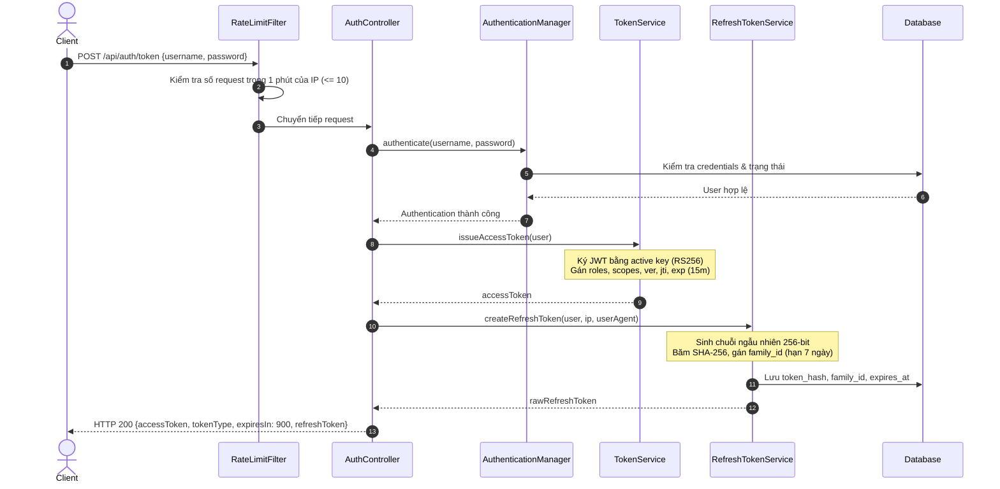
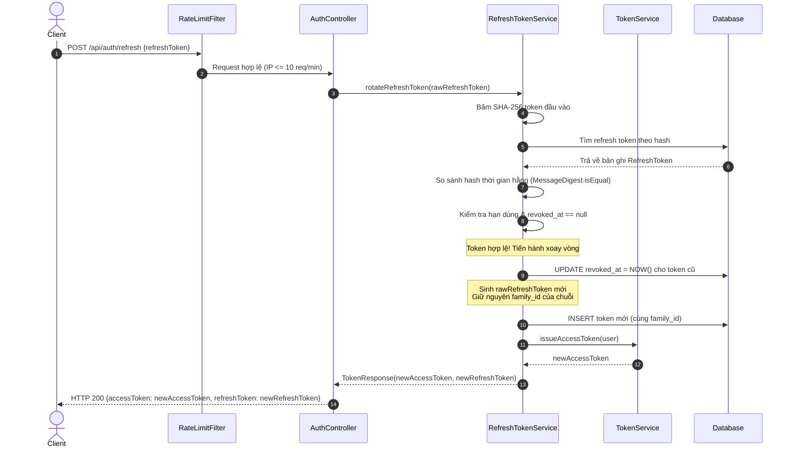
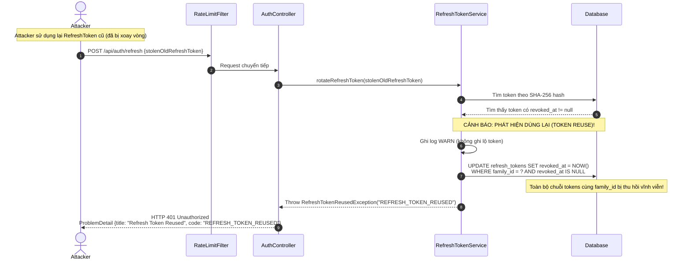

# Catalog API - Bảo vệ REST API bằng JWT với Spring Security 7 & Phiên đăng nhập an toàn

Dự án hoàn thiện toàn bộ các yêu cầu bài tập mục **11. Bài tập: Phiên đăng nhập an toàn cho Catalog API** từ tài liệu *Tutorial: Bảo vệ REST API bằng JWT với Spring Security 7 (OAuth2 Resource Server)*.

---

## 1. Công nghệ & Kiến trúc

- **Framework**: Spring Boot 4.1.1, Java 25 (OpenJDK 26 LTS), Spring Security 7.1.x
- **Bảo mật**: OAuth2 Resource Server (Nimbus JOSE JWT), RSA 2048-bit (RS256), JWK Set
- **Cơ sở dữ liệu**: MySQL 8.4 (Docker Compose) / H2 In-Memory (Test profile)
- **Migration**: Flyway Migration (`V1`, `V2`, `V3`)
- **Tài liệu API**: Springdoc OpenAPI 3.1.0 (Swagger UI tại `/swagger-ui.html`)
- **Tài liệu xuất**: [`docs/api/openapi.yaml`](file:///Users/macbook/T2502E_SEM4/security_spring-boot2/docs/api/openapi.yaml)

---

## 2. Bảng đối chiếu yêu cầu bài tập (R1 - R11)

| Mã | Yêu cầu | Hiện thực trong dự án | Trạng thái |
|:---|:---|:---|:---:|
| **R1** | **Refresh token** | `POST /api/auth/token` trả thêm `refreshToken` là chuỗi ngẫu nhiên 256 bit an toàn (SecureRandom 32 bytes). Database chỉ lưu hash SHA-256 kèm `user_id`, `family_id`, `expires_at` (7 ngày), `revoked_at`, `ip_address`, `user_agent`. | **Đạt** |
| **R2** | **Xoay vòng refresh token** | `POST /api/auth/refresh` nhận refresh token, thu hồi token cũ (`revoked_at = NOW()`), cấp cặp access token và refresh token mới trong cùng `family_id`. | **Đạt** |
| **R3** | **Phát hiện dùng lại** | Nếu một refresh token đã thu hồi được gửi lại, hệ thống lập tức thu hồi toàn bộ token trong `family_id`, ghi log `WARN`, trả mã lỗi HTTP 401 `REFRESH_TOKEN_REUSED` dạng `ProblemDetail`. | **Đạt** |
| **R4** | **Đăng xuất thiết bị hiện tại** | `POST /api/auth/logout` đưa claim `jti` của access token vào bảng `revoked_tokens` cho đến khi token hết hạn; thu hồi refresh token gửi kèm. | **Đạt** |
| **R5** | **Đăng xuất mọi thiết bị** | `POST /api/auth/logout-all` thu hồi tất cả refresh token của user và tăng `token_version` trong bảng `users`. Mọi access token cũ có claim `ver` nhỏ hơn `token_version` bị `JwtDecoder` từ chối ngay lập tức. | **Đạt** |
| **R6** | **Thu hồi khi đổi mật khẩu / khóa tài khoản** | `POST /api/auth/change-password` hoặc ADMIN gọi `POST /api/admin/users/{username}/lock` đều tăng `token_version` và thu hồi toàn bộ refresh token, vô hiệu hóa mọi phiên ngay lập tức. | **Đạt** |
| **R7** | **Xoay khóa ký RSA** | Hỗ trợ nạp đồng thời nhiều khóa RSA phân biệt bằng `kid`. Token mới ký bằng khóa active (`active-kid`). Token ký bằng khóa cũ vẫn hợp lệ đến khi hết hạn. Chuyển đổi khóa active chỉ qua file cấu hình `application.yaml`, không sửa code. | **Đạt** |
| **R8** | **Công bố khóa công khai** | `GET /.well-known/jwks.json` trả về danh sách khóa công khai đang hiệu lực định dạng JWK Set. Sử dụng `jwkSet.toPublicJWKSet().toJSONObject()` đảm bảo tuyệt đối không lộ private key. | **Đạt** |
| **R9** | **Phân quyền theo scope** | Token mang claim `scope` sinh từ role: `ROLE_USER` $\rightarrow$ `product:read`; `ROLE_ADMIN` $\rightarrow$ `product:read product:write`. Thao tác ghi sản phẩm (`POST/PUT/DELETE /api/v1/products/**`) bắt buộc quyền `SCOPE_product:write` ở cả URL trong `SecurityFilterChain` và `@PreAuthorize("hasAuthority('SCOPE_product:write')")`. | **Đạt** |
| **R10** | **Giới hạn tần suất (Rate Limiting)** | `RateLimitFilter` áp dụng trên `/api/auth/token` và `/api/auth/refresh`: tối đa 10 request/phút/IP (sliding window). Vượt quá trả HTTP 429 kèm header `Retry-After` và body `ProblemDetail`. | **Đạt** |
| **R11** | **Tài liệu Swagger UI** | Mọi endpoint được gắn thẻ `@Operation`, `@ApiResponse`, `@SecurityRequirement` đầy đủ các mã lỗi `400`, `401`, `403`, `429`. | **Đạt** |

---

## 3. Đáp ứng yêu cầu phi chức năng (Mục 11.2)

1. **Hiệu lực thu hồi $\le 5$ giây**:
   - `RevocationService` lưu cache trong bộ nhớ với thời gian sống (TTL) tối đa 5 giây cho trạng thái `token_version` và trạng thái tài khoản.
   - Khi có hành động đăng xuất mọi thiết bị hoặc đổi mật khẩu, cache của user được xóa ngay lập tức (`invalidateUserCache`), đảm bảo hiệu lực tức thì.
   - Mỗi request qua tầng kiểm tra token chỉ truy vấn database tối đa 1 lần (hoặc 0 lần nếu trúng cache).
2. **Kiểm tra thu hồi và `token_version` nằm trong `JwtDecoder`**:
   - Sử dụng `JwtRevocationAndVersionValidator` cài đặt `OAuth2TokenValidator<Jwt>`, gán trực tiếp vào `NimbusJwtDecoder.setJwtValidator(...)`.
   - **Tuyệt đối không viết thêm Filter riêng chen vào chuỗi filter security để kiểm tra token**.
3. **Dọn dẹp tự động định kỳ**:
   - `CleanupJob` chạy hàng ngày lúc 03:00 sáng (`@Scheduled(cron = "0 0 3 * * ?")`) để xóa các refresh token và access token jti đã hết hạn trong cơ sở dữ liệu.
4. **An toàn thông tin & Nhật ký**:
   - Không log mật khẩu, access token hay refresh token ở bất kỳ log level nào.
   - So sánh chuỗi băm của refresh token bằng phép so sánh thời gian hằng `MessageDigest.isEqual(...)` chống tấn công timing attack.

---

## 4. Hướng dẫn cấu hình và xoay khóa ký (Key Rotation)

### 4.1. Cấu trúc cấu hình trong `application.yaml`

```yaml
app:
  jwt:
    issuer: catalog-api
    ttl: 15m
    active-kid: key-1 # Khóa đang được dùng để ký token mới
    keys:
      - kid: key-1
        public-key: classpath:keys/app.pub
        private-key: classpath:keys/app.key
      - kid: key-2
        public-key: classpath:keys/public_key.pem
        private-key: classpath:keys/private_key.pem
```

### 4.2. Quy trình xoay khóa không gián đoạn (Zero Downtime)

1. **Bước 1 (Sinh khóa mới)**:
   Sinh cặp khóa RSA mới (ví dụ `key-3`):
   ```bash
   openssl genpkey -algorithm RSA -pkeyopt rsa_keygen_bits:2048 -out src/main/resources/keys/key3.key
   openssl rsa -in src/main/resources/keys/key3.key -pubout -out src/main/resources/keys/key3.pub
   ```
2. **Bước 2 (Thêm khóa vào cấu hình)**:
   Khai báo thêm `key-3` vào danh sách `app.jwt.keys` nhưng giữ nguyên `active-kid: key-1`. Lúc này `GET /.well-known/jwks.json` sẽ công bố cả khóa cũ và mới.
3. **Bước 3 (Chuyển khóa active)**:
   Đổi `app.jwt.active-kid: key-3`.
   - Tất cả token mới phát hành sẽ mang header `kid: "key-3"` và được ký bằng private key của `key-3`.
   - Các token cũ đã ký bằng `key-1` hoặc `key-2` vẫn được `JwtDecoder` giải mã và chấp nhận bình thường cho đến khi hết hạn (15 phút).
   - **Không cần sửa đổi bất kỳ dòng mã nguồn Java nào!**

---

## 5. Sơ đồ trình tự (Sequence Diagrams)

### 5.1. Luồng cấp token lần đầu (`POST /api/auth/token`)



---

### 5.2. Luồng xoay vòng Refresh Token (`POST /api/auth/refresh`)



---

### 5.3. Luồng phát hiện dùng lại Refresh Token (Reuse Detection)



---

## 6. Hướng dẫn chạy và kiểm thử

### 6.1. Chạy ứng dụng

Sử dụng JDK 25 / OpenJDK 26 được cài đặt trên hệ thống:

```bash
JAVA_HOME=/opt/homebrew/opt/openjdk/libexec/openjdk.jdk/Contents/Home ./mvnw spring-boot:run
```

- **Swagger UI**: [http://localhost:8080/swagger-ui.html](http://localhost:8080/swagger-ui.html)
- **Tài liệu OpenAPI Spec**: [http://localhost:8080/v3/api-docs.yaml](http://localhost:8080/v3/api-docs.yaml)
- **Công bố JWKS**: [http://localhost:8080/.well-known/jwks.json](http://localhost:8080/.well-known/jwks.json)

### 6.2. Chạy toàn bộ Test tự động

```bash
JAVA_HOME=/opt/homebrew/opt/openjdk/libexec/openjdk.jdk/Contents/Home ./mvnw test
```

Bộ test tự động [`ApiSecurityTest`](file:///Users/macbook/T2502E_SEM4/security_spring-boot2/src/test/java/com/sem4/security_springboot2/ApiSecurityTest.java) chứng minh đầy đủ 100% các tiêu chí nghiệm thu của bài tập:
1. `refreshTokenRotationSuccess`: Xoay vòng refresh token thành công, nhận cặp access + refresh token mới.
2. `reuseOldRefreshTokenRevokesFamily`: Dùng lại refresh token cũ làm cả chuỗi family bị thu hồi, trả 401 `REFRESH_TOKEN_REUSED`.
3. `accessTokenRejectedAfterLogout`: Access token bị từ chối sau khi logout (đưa `jti` vào danh sách thu hồi).
4. `allTokensRejectedAfterLogoutAllAndChangePassword`: Mọi token bị từ chối sau `logout-all` và sau đổi mật khẩu (so sánh `ver` với `token_version`).
5. `adminLockUserRevokesAllTokensImmediately`: ADMIN khóa tài khoản làm vô hiệu hóa toàn bộ token của user và cấm đăng nhập ngay lập tức (R6).
6. `tokenSignedWithOldKeyIsAccepted`: Token ký bằng khóa cũ (`test-key-2`) vẫn được chấp nhận hợp lệ.
7. `tokenWithUnknownKidIsRejected`: Token có `kid` lạ không tồn tại trong JWK Set bị từ chối 401.
8. `rateLimiterReturns429OnEleventhRequest`: Request thứ 11 trong 1 phút tới `/api/auth/token` nhận HTTP 429 kèm header `Retry-After` và body `ProblemDetail`.
9. `jwksEndpointPublishesPublicKeysOnly`: Endpoint `/.well-known/jwks.json` công bố đúng khóa công khai và tuyệt đối không lộ khóa bí mật.
10. `adminScopeCanCreateProduct` & `userRoleCannotCreateProduct`: Phân quyền thao tác ghi theo `SCOPE_product:write`.
11. `serviceRejectsNonAdminEvenWithoutHttp`: Lớp bảo vệ thứ 2 chặn trực tiếp tại tầng service qua `@PreAuthorize`.
12. `exportOpenApiYaml`: Tự động xuất tài liệu [`docs/api/openapi.yaml`](file:///Users/macbook/T2502E_SEM4/security_spring-boot2/docs/api/openapi.yaml) chuẩn UTF-8 từ SpringDoc.
